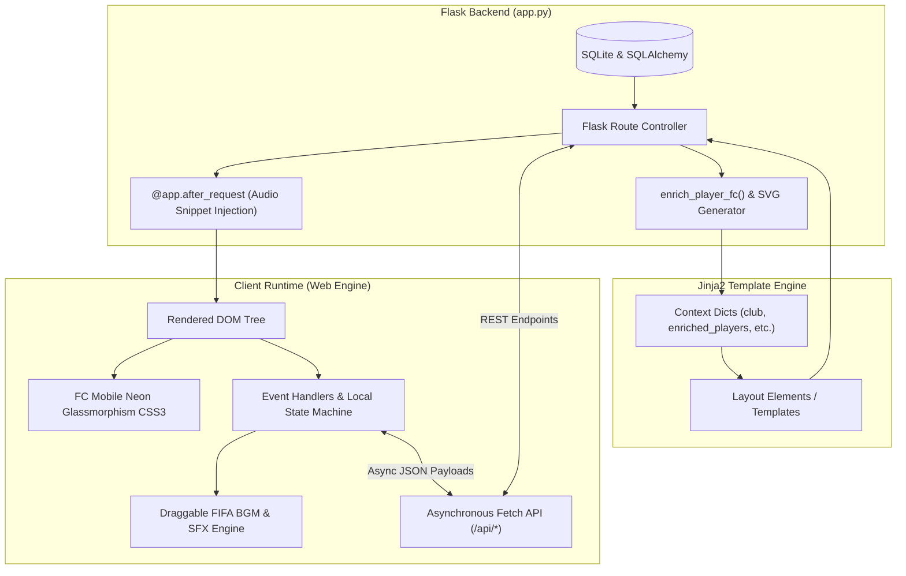
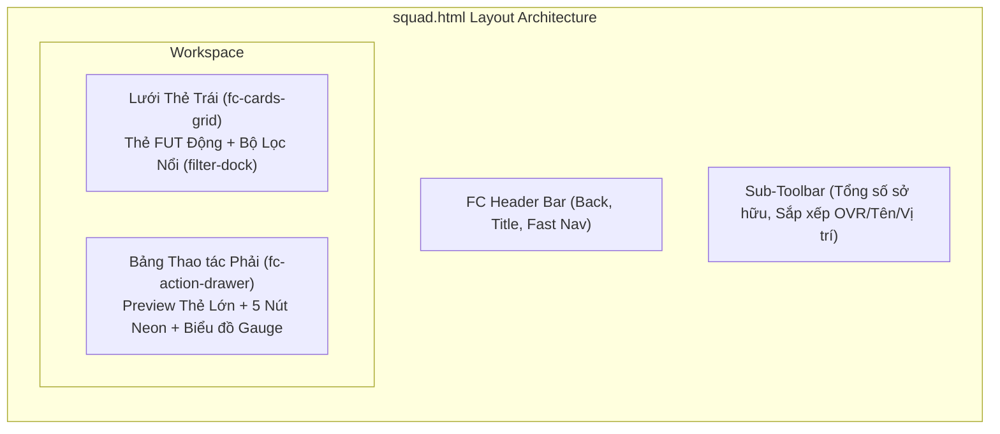
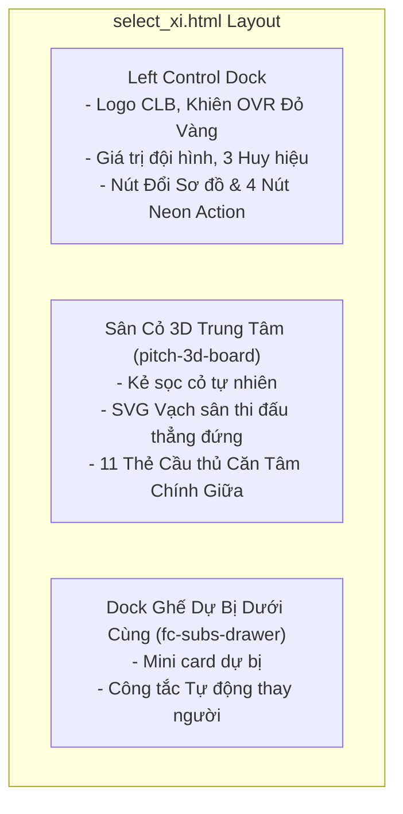
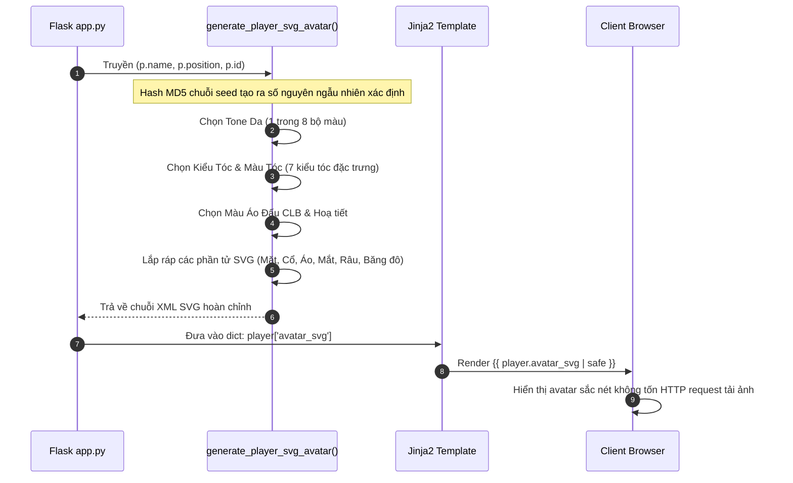

# TÀI LIỆU KỸ THUẬT KIẾN TRÚC FRONTEND & TEMPLATES (JINJA2)
**Hệ thống:** Football Manager Web (Phiên bản FC Mobile 24/25 Edition)  
**Tác giả:** Kỹ sư Trưởng Phát triển Hệ thống (Lead Software Engineer)  
**Mục tiêu:** Cung cấp tài liệu kỹ thuật toàn diện về toàn bộ tầng trình diễn (Presentation Layer / View Layer), bao gồm cấu trúc thư mục templates, ngôn ngữ thiết kế (Design System), hợp đồng dữ liệu (Data Contracts), kiến trúc component SVG/CSS 3D và cơ chế tương tác bất đồng bộ (AJAX/REST APIs).

---

## MỤC LỤC
1. [Tổng quan Kiến trúc Tầng Trình diễn (Presentation Layer Architecture)](#1-tổng-quan-kiến-trúc-tầng-trình-diễn)
2. [Hệ thống Thiết kế (FC Mobile Design System & Style Guide)](#2-hệ-thống-thiết-kế-fc-mobile-design-system)
3. [Phân loại & Bản đồ Template (Template Sitemap & Taxonomy)](#3-phân-loại--bản-đồ-template)
4. [Đặc tả Chi tiết Từng Module Template & Data Contracts](#4-đặc-tả-chi-tiết-từng-module-template--data-contracts)
   - 4.1 [Module Quản lý Thẻ Cầu thủ (`squad.html`)](#41-module-quản-lý-thẻ-cầu-thủ-squadhtml)
   - 4.2 [Module Sắp xếp Đội hình Sân cỏ 3D (`select_xi.html`)](#42-module-sắp-xếp-đội-hình-sân-cỏ-3d-select_xihtml)
   - 4.3 [Module Hồ sơ & Thanh tra Cầu thủ 5 Tab (`player_detail.html`)](#43-module-hồ-sơ--thanh-tra-cầu-thủ-5-tab-player_detailhtml)
   - 4.4 [Module Bảng Điều khiển Trung tâm (`dashboard.html`)](#44-module-bảng-điều-khiển-trung-tâm-dashboardhtml)
   - 4.5 [Module Mô phỏng Trận đấu Trực tiếp (`live_match.html`)](#45-module-mô-phỏng-trận-đấu-trực-tiếp-live_matchhtml)
   - 4.6 [Các Module Vận hành & Tài chính (Thị trường, Học viện, Tài trợ, v.v.)](#46-các-module-vận-hành--tài-chính)
5. [Hệ thống Component Vector SVG & Thẻ FUT Động](#5-hệ-thống-component-vector-svg--thẻ-fut-động)
6. [Hệ thống Âm thanh Toàn cục & Draggable Widget (Web Audio System)](#6-hệ-thống-âm-thanh-toàn-cục--draggable-widget)
7. [Luồng Giao tiếp Bất đồng bộ (Client-Server AJAX Flow)](#7-luồng-giao-tiếp-bất-đồng-bộ)
8. [Quy chuẩn Mở rộng & Hướng dẫn Bảo trì (Maintenance & Extension Guidelines)](#8-quy-chuẩn-mở-rộng--hướng-dẫn-bảo-trì)

---

## 1. TỔNG QUAN KIẾN TRÚC TẦNG TRÌNH DIỄN

Hệ thống Frontend của dự án áp dụng mô hình **Server-Side Rendering (SSR) tăng cường Hydration với Vanilla JavaScript & CSS3 Hiện đại**, không phụ thuộc vào các framework nặng (như React/Vue/Angular), đảm bảo tốc độ render tức thì, chi phí runtime cực thấp và tối ưu hóa tối đa trải nghiệm người dùng cục bộ (desktop/web embed).



---

## 2. HỆ THỐNG THIẾT KẾ (FC MOBILE DESIGN SYSTEM)

Giao diện áp dụng chuẩn thiết kế **FC Mobile (FUT 24/25)** với nền tối vũ trụ kết hợp ánh sáng dạ quang Neon (Cyan, Amber Gold, Emerald Green) và hiệu ứng kính mờ (Glassmorphism).

### 2.1 Bảng màu cốt lõi (CSS Custom Properties)
```css
:root {
    --bg-dark: #030712;                 /* Nền đen sâu chủ đạo */
    --panel-bg: rgba(6, 12, 28, 0.94);  /* Nền kính mờ cao cấp */
    --panel-border: rgba(56, 189, 248, 0.35); /* Viền cyan mờ */
    --primary: #10b981;                 /* Xanh lá chiến thắng / Đá chính */
    --accent: #38bdf8;                  /* Xanh lơ thương hiệu FC */
    --accent-cyan: #00f2fe;             /* Cyan dạ quang cực sáng */
    --gold: #f59e0b;                    /* Vàng hoàng kim TOTY */
    --gold-glow: rgba(245, 158, 11, 0.5);
    --danger: #ef4444;                  /* Đỏ thẻ phạt / Cảnh báo */
    --text-main: #f8fafc;               /* Trắng sáng tương phản cao */
    --text-muted: #94a3b8;              /* Xám bạc phụ đề */
}
```

### 2.2 Quy chuẩn phân cấp Thẻ Cầu thủ (Card Tier Hierarchy)
* **Tier UCL / Siêu sao (`.tier-ucl`)**: Dành cho cầu thủ có OVR $\ge 85$. Nền xanh tím thẫm đa tầng (`#0c2b64 ➔ #040d21`), viền phát quang xanh biển sâu, hiệu ứng tia sáng xanh lơ.
* **Tier Gold / Tinh anh (`.tier-gold`)**: Dành cho cầu thủ có OVR từ $74$ đến $84$. Nền vàng đồng hoàng gia (`#452a03 ➔ #170d01`), viền vàng ánh kim TOTY.
* **Tier Silver / Tiêu chuẩn (`.tier-silver`)**: Dành cho cầu thủ có OVR $< 74$. Nền xám carbon kim loại (`#1e293b ➔ #090e17`), viền xám bạc sang trọng.

---

## 3. PHÂN LOẠI & BẢN ĐỒ TEMPLATE

Toàn bộ thư mục `templates/` được phân tách theo chức năng rõ ràng thành 5 phân hệ chính:

| STT | Phân hệ (Subsystem) | File Template tiêu biểu | Mô tả chức năng |
|---|---|---|---|
| **1** | **Quản lý Đội hình & Cầu thủ** | `squad.html`, `select_xi.html`, `player_detail.html`, `player_stats.html` | Kho thẻ bài, bố trí sân bóng 3D, thanh tra 24+ chỉ số, đua danh hiệu cá nhân. |
| **2** | **Trung tâm Điều hành CLB** | `dashboard.html`, `index.html`, `create_club.html`, `tutorial.html` | Bảng tin quản lý, khởi tạo CLB, hướng dẫn người chơi mới. |
| **3** | **Vận hành Kinh tế & Chuyển nhượng**| `transfer_market.html`, `youth_academy.html`, `sponsorship.html`, `salary.html` | Đàm phán mua bán cầu thủ, săn Wonderkids 4 châu lục, ký kết nhà tài trợ, quỹ lương. |
| **4** | **Thi đấu & Mô phỏng Trận đấu** | `live_match.html`, `match.html`, `result.html`, `match_history.html`, `substitution.html` | Mô phỏng 2D thời gian thực, audio reo hò, tường thuật chi tiết, thay người chiến thuật. |
| **5** | **Giải đấu & Lưu trữ** | `standings.html`, `schedule.html`, `trophy_room.html`, `season_end.html`, `save.html`, `load.html` | BXH giải VĐQG/Hạng 2, lịch thi đấu, phòng cúp 3D, mã passcode lưu trữ. |

---

## 4. ĐẶC TẢ CHI TIẾT TỪNG MODULE TEMPLATE & DATA CONTRACTS

### 4.1 Module Quản lý Thẻ Cầu thủ (`squad.html`)
* **Đường dẫn Route:** `GET /squad`
* **Mục tiêu kỹ thuật:** Tái hiện trung thực giao diện quản lý kho thẻ cầu thủ (Player Inventory) của FC Mobile.



#### Hợp đồng dữ liệu (Jinja2 Context):
```python
{
    "club": Club,                      # Đối tượng SQLAlchemy CLB sở hữu
    "enriched_players": list[dict],    # Danh sách dữ liệu làm giàu từ enrich_player_fc()
    "starting_players": list[dict],    # 11 cầu thủ đá chính
    "sub_players": list[dict],         # Các cầu thủ dự bị
    "team_ovr": int,                   # OVR trung bình đội
    "team_value": int                  # Tổng giá trị chuyển nhượng đội bóng
}
```

#### Các hành vi JavaScript & REST Endpoints:
1. `selectPlayer(id)`: Lắng nghe sự kiện click trên từng card, cập nhật highlight viền `#00f2fe` và truyền toàn bộ dữ liệu chỉ số lên **Bảng thao tác bên phải** (Action Drawer).
2. `toggleFilterTray()` / `setFilter(type, btn)`: Lọc client-side không cần tải lại trang (`ALL`, `FW`, `MF`, `DF`, `GK`, `XI`).
3. `applySorting()`: Sắp xếp động các thẻ DOM theo `OVR`, `Tên`, `Vị trí`, `Cấp huấn luyện`, `Hạng kim cương`.
4. **5 Nút Thao Tác Trực Tiếp:**
   - `🔍 CHI TIẾT`: Điều hướng tới `/player/<id>`.
   - `⚡ HUẤN LUYỆN`: Gọi `POST /api/train_player` (tăng cấp huấn luyện, cập nhật thuộc tính tại chỗ).
   - `⭐ THĂNG HẠNG`: Gọi `POST /api/rankup_player` (tăng cấp sao Kim Cương, +2 OVR).
   - `🔥 ĐIỂM KỸ NĂNG`: Gọi `POST /api/skill_boost_player` (nâng skill boost).
   - `🔄 CHUYỂN ĐIỂM HUẤN LUYỆN`: Gọi `POST /api/transfer_training` (chuyển cấp huấn luyện giữa 2 cầu thủ).

---

### 4.2 Module Sắp xếp Đội hình Sân cỏ 3D (`select_xi.html`)
* **Đường dẫn Route:** `GET/POST /select_xi`
* **Mục tiêu kỹ thuật:** Sân cỏ vận động 3D lập thể với vạch kẻ chuẩn dọc (Vertical Pitch), hỗ trợ đổi vị trí 1-click hoặc kéo thả, tự động cân bằng đội hình vào tâm giữa sân.



#### Thuật toán cốt lõi Client-side: `mapLineupToFormation(players, formation)`
Đảm bảo khi chuyển đổi giữa bất kỳ sơ đồ nào (`4-3-3`, `4-2-3-1`, `5-3-2`, `4-4-2`, `3-5-2`), các cầu thủ luôn được nhóm theo hàng chuẩn (`FW`, `MF`, `DF`, `GK`) và căn đúng vào tâm đối xứng của sân vận động, không bị lệch lề:
```javascript
// Phân bổ hàng và tính điểm phù hợp vị trí:
const slotDefs = {
    '4-3-3': [
        { row: 'FW', slots: ['LW', 'ST', 'RW'] },
        { row: 'MF', slots: ['CM', 'CAM', 'CM'] },
        { row: 'DF', slots: ['LB', 'CB', 'CB', 'RB'] },
        { row: 'GK', slots: ['GK'] }
    ],
    // ...
};
```

#### Cơ chế Hoán đổi Vị trí (Player Swapping Mechanism):
* Người dùng click thẻ A trên sân $\to$ Thẻ A kích hoạt hiệu ứng thở neon cyan (`.active-swap-source`).
* Người dùng click thẻ B (trên sân hoặc ở khay dự bị) $\to$ Hệ thống kích hoạt hàm `executeSwap(p1Id, p2Id)` gửi JSON lên `POST /api/swap_squad_players`.
* DOM tự động tái cấu trúc lại vị trí của 2 cầu thủ ngay lập tức mà không làm reload trình duyệt.

---

### 4.3 Module Hồ sơ & Thanh tra Cầu thủ 5 Tab (`player_detail.html`)
* **Đường dẫn Route:** `GET /player/<int:player_id>`
* **Mục tiêu kỹ thuật:** Thanh tra toàn diện mọi thông tin kỹ thuật, phong cách thi đấu và định giá chuyển nhượng của từng cá nhân cầu thủ.

#### Cấu trúc 5 Tab tương tác:
1. **Tab 1: TỔNG KẾT (Summary):** Hiển thị thẻ cầu thủ 3D kích thước đầy đủ, 6 chỉ số chính (PAC, SHO, PAS, DRI, DEF, PHY), thông số thể chất (chiều cao, cân nặng, chân thuận, sao skill moves).
2. **Tab 2: THUỘC TÍNH (Detailed Attributes):** Bảng chi tiết 24+ chỉ số chuyên sâu chia theo 6 nhóm kỹ năng, có thanh tiến trình động theo ngưỡng giá trị 0–250.
3. **Tab 3: LỐI ĐÁ (PlayStyles):** Hệ thống đặc tính phong cách (Sút xoáy, Rê bóng thần tốc, Chọc khe điểm rơi, Không chiến uy lực).
4. **Tab 4: CHỈ SỐ ẨN (Traits):** Tính cách thi đấu, khả năng lãnh đạo, độ bền bỉ trong các trận cầu lớn.
5. **Tab 5: CHUYỂN NHƯỢNG (Transfer Market Status):** Biểu đồ giá trị thị trường, mức lương hiện tại, thời hạn hợp đồng và trạng thái mở bán.

---

### 4.4 Module Bảng Điều khiển Trung tâm (`dashboard.html`)
* **Đường dẫn Route:** `GET /dashboard`
* **Mục tiêu kỹ thuật:** Bảng điều khiển tác nghiệp của Huấn Luyện Viên Trưởng.
* **Các thành phần chính:**
  - Header thống kê tài chính ngân sách CLB, điểm số, thứ hạng hiện tại và vòng đấu.
  - Widget tóm tắt trận đấu sắp tới (Đối thủ tiếp theo, chiến thuật dự kiến).
  - Lưới các thẻ tác nghiệp (Navigation Menu Cards): Đi tới Đội hình, Chọn 11 đá chính, Trung tâm huấn luyện, Thị trường chuyển nhượng, Học viện trẻ, Phòng truyền thống, Nhà tài trợ, Bảng xếp hạng.

---

### 4.5 Module Mô phỏng Trận đấu Trực tiếp (`live_match.html`)
* **Đường dẫn Route:** `GET /live_match`
* **Mục tiêu kỹ thuật:** Đấu trường mô phỏng 2D kết hợp engine tính toán xác suất bàn thắng, audio cổ vũ sân cỏ chân thực.
* **Kiến trúc đặc thù:**
  - Tích hợp Canvas / HTML5 rendering trận đấu.
  - Luồng Event Stream định kỳ nhận dữ liệu từ `POST /simulate_minute`.
  - Bộ điều khiển thay người chiến thuật trong trận (`substitute`).
  - Tự động ngắt nhạc nền FIFA thông qua hook để nhường quyền ưu tiên cho âm thanh sân cỏ (tiếng còi, tiếng ho reo, tiếng sút bóng).

---

### 4.6 Các Module Vận hành & Tài chính
* `transfer_market.html`: Giao diện 2 tab "Mua Cầu Thủ" và "Bán Cầu Thủ", hỗ trợ gửi lời đề nghị chuyển nhượng, đàm phán lương và mức phí giải phóng hợp đồng.
* `youth_academy.html`: Quản lý 4 lò tuyển trạch (Việt Nam, Nam Mỹ, Châu Âu, Châu Phi) với chi phí và tỉ lệ xuất hiện Wonderkid khác nhau; đào tạo điểm tiềm năng và đôn lên đội 1.
* `sponsorship.html`: Ký kết hợp đồng tài trợ ngân hàng / trang phục (VietinBank Sport, Emirates, Nike) bổ sung ngân sách định kỳ theo tuần và thưởng trận thắng.
* `trophy_room.html`: Phòng trưng bày cúp vô địch V-League 2, Cúp Quốc Gia và UEFA Champions League dạng 3D card.

---

## 5. HỆ THỐNG COMPONENT VECTOR SVG & THẺ FUT ĐỘNG

Nhằm giải quyết triệt để vấn đề phụ thuộc vào ảnh tĩnh bên ngoài (tránh hiện tượng ảnh vỡ hoặc hiển thị trùng lặp chân dung siêu sao như Doku cho tất cả người chơi), hệ thống được trang bị engine sinh chân dung vector SVG tự động:



### Ưu điểm kỹ thuật:
1. **Zero Asset Overhead:** Không cần lưu trữ hàng nghìn file `.png` trên đĩa cứng; tiết kiệm 100% băng thông tải ảnh.
2. **Deterministic Output:** Cùng một cầu thủ (cùng ID và Tên) luôn sinh ra cùng một khuôn mặt đại diện duy nhất trong suốt mùa giải.
3. **Responsive Vector Quality:** Ảnh hiển thị sắc nét tuyệt đối trên mọi màn hình độ phân giải cao (Retina/4K).

---

## 6. HỆ THỐNG ÂM THANH TOÀN CỤC & DRAGGABLE WIDGET

Hệ thống âm thanh được xây dựng dưới dạng **Global Injected Component** thông qua decorator `@app.after_request` trong file `app.py`. Mọi trang HTML trả về từ server đều tự động tích hợp trình phát nhạc FIFA và bộ âm thanh hiệu ứng (SFX) mà lập trình viên không cần copy-paste vào từng file template.

### 6.1 Cơ chế tiêm mã động (`auto_inject_audio_system`)
```python
@app.after_request
def auto_inject_audio_system(response):
    if response.status_code == 200 and 'text/html' in response.headers.get('Content-Type', ''):
        try:
            html = response.get_data(as_text=True)
            if '</body>' in html:
                html = html.replace('</body>', f'{GLOBAL_AUDIO_SNIPPET}\n</body>', 1)
                response.set_data(html)
        except Exception:
            pass
    return response
```

### 6.2 Các tính năng nổi bật của Widget:
* **Draggable Physics:** Người dùng có thể kéo thả widget âm thanh tới bất kỳ vị trí nào trên màn hình. Vị trí tọa độ `(left, top)` được lưu trữ liên tục vào `localStorage('fifa_widget_pos')` để giữ nguyên vị trí qua các lần chuyển trang.
* **Continuous Playback:** Thời gian phát nhạc (`currentTime`), bài hát đang phát (`track_idx`), âm lượng (`volume`) và trạng thái trộn bài (`shuffle`) được đồng bộ thông qua `localStorage`.
* **Universal Button SFX:** Tự động lắng nghe sự kiện click trên các thẻ `a, button, select, input, .btn, [onclick]` để phát âm thanh phản hồi vật lý (`/sounds/sfx/Click.wav`).

---

## 7. LUỒNG GIAO TIẾP BẤT ĐỒNG BỘ (CLIENT-SERVER AJAX FLOW)

Tất cả các hành động tác vụ của người chơi trong màn hình Đội hình đều tuân thủ mô hình RESTful JSON:

| Endpoint | Method | Payload Gửi đi | Phản hồi Trả về (JSON) | Mục đích |
|---|---|---|---|---|
| `/api/train_player` | `POST` | `{"player_id": int}` | `{success: bool, player: dict, club_money: int}` | Huấn luyện tăng 1 cấp, tăng chỉ số & trừ tiền |
| `/api/rankup_player` | `POST` | `{"player_id": int}` | `{success: bool, player: dict, club_money: int}` | Thăng hạng kim cương (+1 sao, +2 OVR) |
| `/api/skill_boost_player` | `POST` | `{"player_id": int}` | `{success: bool, player: dict, club_money: int}` | Nâng cấp điểm kỹ năng đặc thù |
| `/api/transfer_training` | `POST` | `{"source_player_id": int, "target_player_id": int}` | `{success: bool, source_player: dict, target_player: dict}` | Chuyển toàn bộ cấp huấn luyện giữa 2 cầu thủ |
| `/api/swap_squad_players` | `POST` | `{"p1_id": int, "p2_id": int}` | `{success: bool, starting_players: list, sub_players: list, team_ovr: int}` | Hoán đổi 2 cầu thủ giữa sân chính hoặc dự bị |
| `/api/auto_build_squad` | `POST` | `{}` | `{success: bool, starting_players: list, sub_players: list, team_ovr: int}` | Thuật toán AI tự động xếp 11 cầu thủ tối ưu |
| `/api/change_formation` | `POST` | `{"formation": str}` | `{success: bool, formation: str, starting_players: list, ...}` | Thay đổi sơ đồ chiến thuật CLB |

---

## 8. QUY CHUẨN MỞ RỘNG & HƯỚNG DẪN BẢO TRÌ

Dành cho các kỹ sư tiếp quản hoặc phát triển tính năng mới trong tương lai:

### 8.1 Quy tắc thêm trang mới (Adding a New Template)
1. **Kế thừa Theme chung:** Luôn sử dụng biến màu CSS toàn cục (`--bg-dark`, `--panel-bg`, `--accent-cyan`).
2. **Không chèn lại mã Audio:** Không copy mã phát nhạc FIFA hay widget kéo thả vào template mới vì `@app.after_request` đã tự động làm việc này.
3. **Thẻ cầu thủ thống nhất:** Khi cần hiển thị thẻ cầu thủ, hãy sử dụng cấu trúc `.fc-fut-card` đi kèm `{{ player.avatar_svg | safe }}` để bảo đảm tính nhất quán trên toàn hệ thống.

### 8.2 Quy tắc viết JavaScript trong Template
* Luôn bọc logic khởi tạo trong `document.addEventListener('DOMContentLoaded', ...)` hoặc đặt script ở cuối thẻ `body`.
* Đối với các tác vụ làm thay đổi trạng thái (State Mutation), ưu tiên sử dụng `fetch()` bất đồng bộ thay vì submit form toàn trang để tránh nhấp nháy màn hình và duy trì phát nhạc mượt mà.
* Tích hợp âm thanh phản hồi: Khi thực hiện thành công một thao tác nâng cấp hoặc lưu, hãy gọi hàm phát âm thanh `playSound(sfxWhistle)` hoặc `playSound(sfxClick)`.

---
*Tài liệu được lập và lưu trữ chính thức tại kho mã nguồn dự án: `c:\Users\Admin\Desktop\football_manager_web\TEMPLATES_DOCUMENTATION.md`.*
